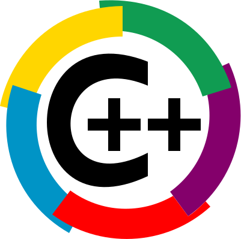

# Welcome to C++ FRUG!

<!-- _footer: "" -->

---

# #65!

---
## I am you host

For the 14th time
- Vivien MILLE
- Staff Engineer & Code cleaner at BNPP CIB

---
# Schedule

---
## Schedule

- 19h00 Welcome
- 19h15 News of the C++ ecosystem
- 19h20 Lightning talks
- 19h50 Snacks & drinks
- 20h20 Talks:
  - Thibault RICORD-MARCHAL - The standard `constexpr` object notation we underestimate
  - Arnaud BECHELER - Boost Graph Modernization Workshop 2026: Outcomes & Next Steps
  - Adrien HENROT - Serial Tuple Experiment Kumi
  - Vivien MILLE - Distribute Visual Studio in your company: from nightmare to ok(ish)
  
---
# C++FrUG

---
## C++FrUG

You can participate !

---
## C++FrUG

Propose a talk !

We can help to build your presentation and adapt the agenda

Remainder:
* Lightning talk
* Short talk (15-30 minutes)
* Full-fledged talk (50-60 minutes)

---

## C++FrUG

Host a C++ meetup !

You can:
* host the event (in your company, in a rented room)
* sponsor snacks & drinks

---
## C++FrUG

Join the Discord servers

[C++FrUG](https://discord.gg/YmKMABu9)

[Meetup](https://discord.gg/3K69BvqK)

---
## Conferences

- ACCU on Sea: 17-20 June, Folkstone, EN
- CppCon: 12-18 Sep, Aurora, US
- NDC Techdown: 21-24 Sep, Kongsberg, NO
- C++ Under the Sea: 15-16 Oct, Breda, NE
- MeetingCpp: 26-28 Nov, Berlin, GE

---
## Sponsor

Thank you !

---
# Learn and share our knowledge of the C++ !
