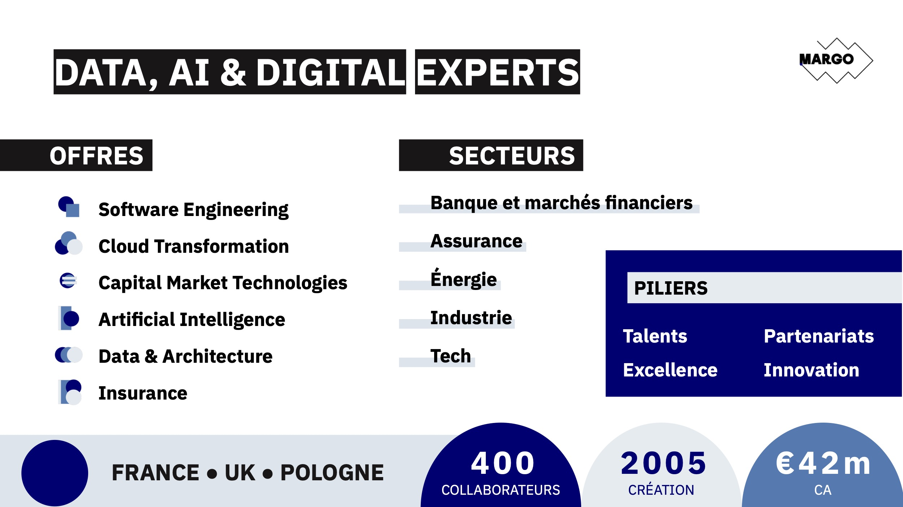

# Welcome to C++ FRUG!

<!-- _footer: "" -->

---

# #66!

---
## I am you host

For the 15th time
- Vivien MILLE
- Staff Engineer & Code cleaner at BNPP CIB

---
# Schedule

---
## Schedule

- 19h15 News of the C++ ecosystem
- 19h20 Lightning talks
- 19h50 Snacks & drinks
- 20h20 Talks:
  - short - Joël FALCOU - TTS, des tests oui, mais des panzanis
  - short - Thibault RICORD-MARCHAL - TBA
  - LT - Louise KRAFFE - HAMT
  - LT - Yacine BENAFFANE - False sharing
  - short - Vivien MILLE - Rule of 0/5/12/π and lifetime stuff
  
---
# C++FrUG

---
## C++FrUG

You can participate !*

---
## C++FrUG

Propose a talk !

We can help to build your presentation and adapt the agenda

Remainder:
* Lightning talk
* Short talk (15-30 minutes)
* Full-fledged talk (50-60 minutes)

---

## C++FrUG

Host a C++ meetup !

You can:
* host the event (in your company, in a rented room)
* sponsor snacks & drinks

---
## C++FrUG

Join the Discord servers

[C++FrUG](https://discord.gg/YmKMABu9)

[Meetup](https://discord.gg/3K69BvqK)

---
## News

* MISRA C++ 2023

---
## News

- MISRA C++ 2023 (erratum)
* LLVM 23
* ISO C++ meeting - Búzios BR - November 16-21

---
## Conferences

- MeetingCpp: 26-28 Nov, Berlin, GE
- C++Online: 10-12 Mar

---
## Sponsor

Thank you !

---

---
# Announcement

---
# Learn and share our knowledge of the C++ !
