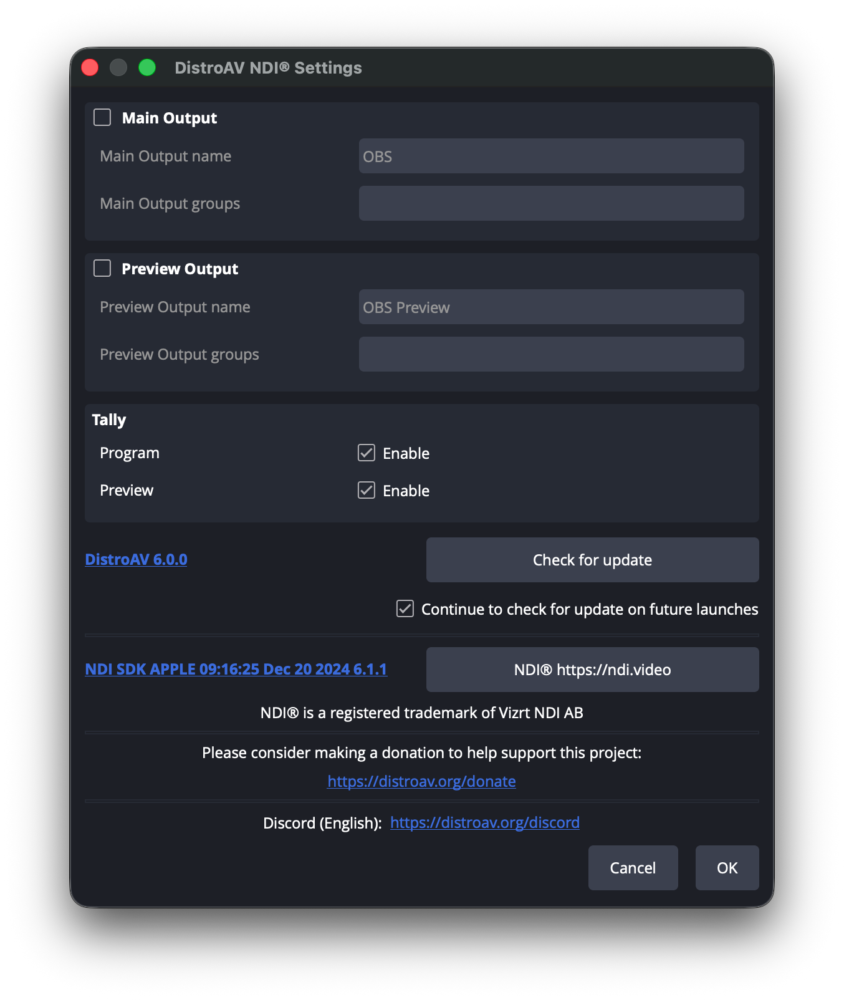
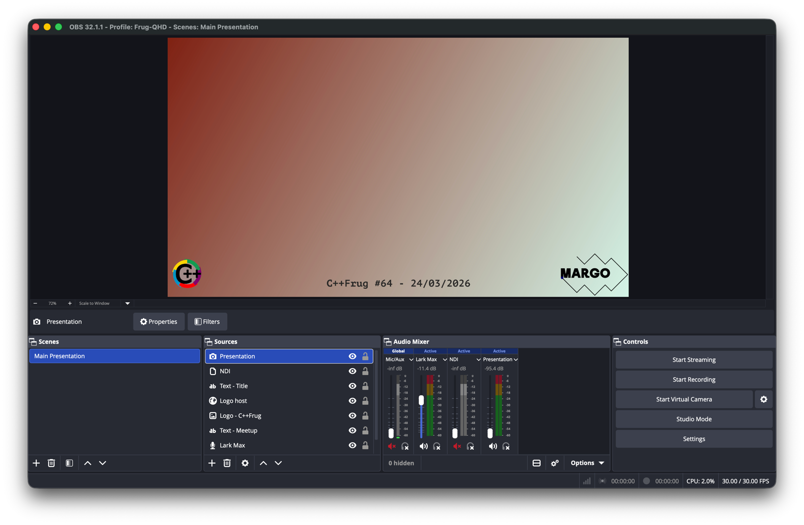
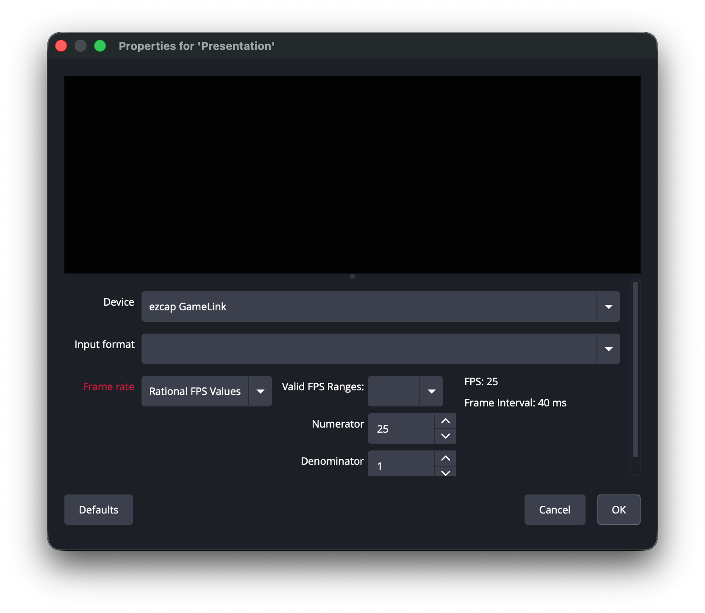
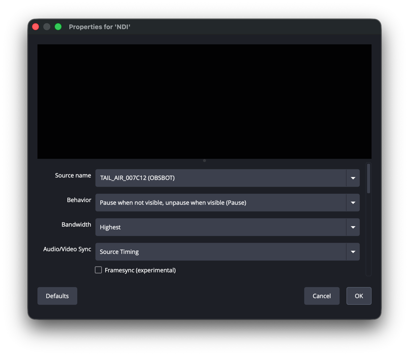
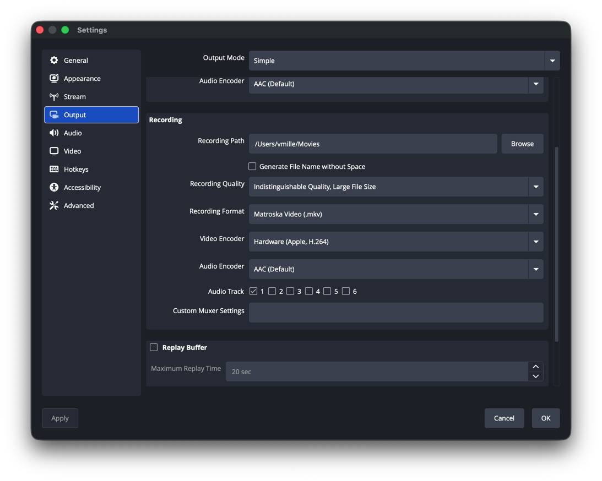
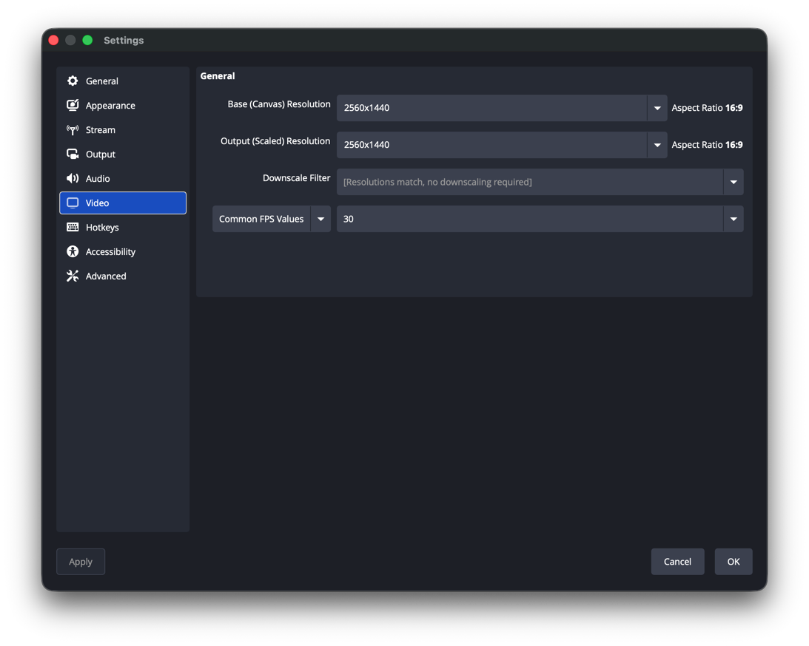

# Hardware setup of the CppFrug

## List of hardware

- Camera: Obsbot Tail Air + remote
- Micro: Hollyland Lark Max
- HDMI passthrough recorder: MYPIN 4k
- Presenter support: Surface Pro 7
- 4G / Wi-Fi router: TP-Link Archer MR402
- Tripod
- Battery
- Various cables & adapter

What's missing: a laptop to perform the capture and retransmission (2 USB ports needed)

## Prerequisites

- Battery charged
- Camera charged
- Remote of the camera charged
- Micro charged
- Install Obsbot Start application on a phone
- Connect the laptop to the Wi-Fi router
- Connect the camera to the Wi-Fi router
- OBS installed and setup (see after) on the retransmission laptop

## Setup

- Plug the Wi-Fi router
- Put the tripod in front of the speaker & rotate the head (on the side, a small lock needs to be unlock then play around to let the table be vertical)
- Mount the camera on the tripod and power it up
- Plug the camera to the battery
- Plug the retransmission laptop 
- Plug the micro (small box between the 2 mics) to the laptop with USB cable
- Plug the HDMI passthrough recorder to the laptop (blue USB cable)
- Plug the speaker laptop to the Input port of the HDMI recorder
- Plug the screen/projector to the Output port of the HDMI recorder
- Set the camera in NDI mode in Obsstart application + vertical mode
- Prepare one of the micro for the speaker & let the other in the box (as long as in the box, it is not activated) for questions
- Run OBS
- Start Recording
- Start Virtual Camera (check if Main Presentation is selected)
- Open Discord and select OBS Virtual Camera as webcam & Wireless Rx as micro

## OBS

- Install OBS: https://obsproject.com/download
- Install NDI tools (to detect and import the camera stream): https://ndi.video/tools/
- Install DistroAV (to stream the camera into OBS): https://obsproject.com/forum/resources/distroav-network-audio-video-in-obs-studio-using-ndi%C2%AE-technology.528/
- Open OBS
- Check if NDI & co are correctly installed: Tools->DistroAV should look like 
- Import the FrugQHD/basic.ini file (Profile->Import). It should look like 
- In the Sources tab, you have the list of inputs :
  - Presentation: HDMI recorder, in the center of the image (not visible here). ezcap should be selected: 
  - NDI: camera via Wi-Fi, in the right of the image (not visible here). TAIL_AIR should be selected 
  - Text - Title: title of the event (empty here)
  - Logo host: logo to the left (here HTML but can be an image)
  - Logo C++Frug: logo to the right
  - Text Meetup: event subtype + date
  - Lark Max: micro. Wireless Rx should be selected
  - Background: image 
- Audio Mixer: every one to mute except Lark Max
- Other settings:
  - Settings->Output: 
  - Settings->Video: 
  - Edit->Advanced Audio Properties (only if lip sync issue): 

I recommend to record & stream at least 2.5k (2160px to ensure correct quality)